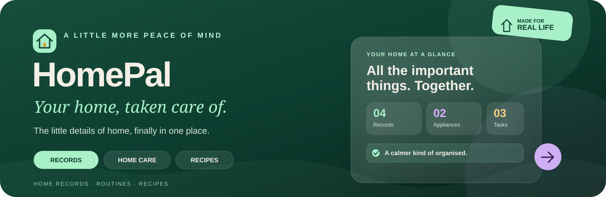
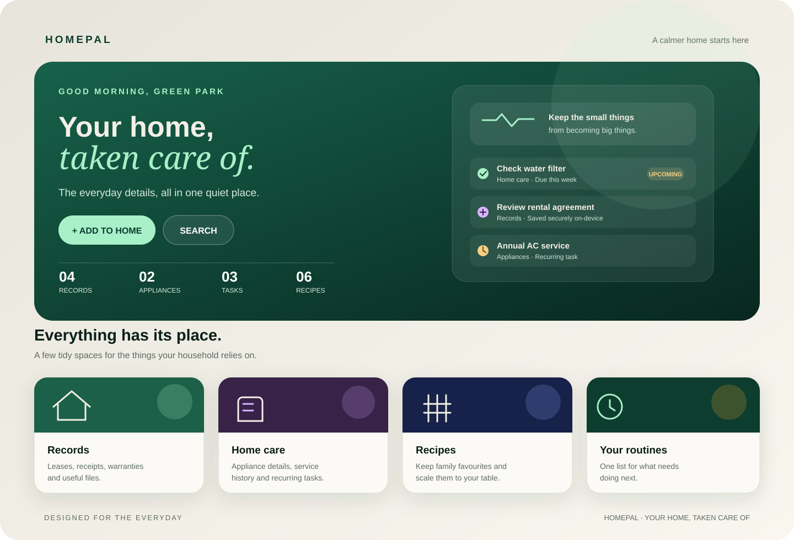

  

  
<strong>Less household admin. More peace of mind.</strong>

  

  

    
    
    
  

## A peek inside

HomePal brings the useful, easily-forgotten details of running a home into one calm, mobile-first place.

## What it keeps together

- **Home records** — agreements, deposits, receipts, invoices, warranties, manuals, photos and PDFs.
- **Move-in / move-out inspections** — room-by-room condition notes, photos, and pre-existing issues.
- **Home care** — appliances, warranty dates, service intervals, recurring tasks and repair history.
- **Tasks & recipes** — due dates, repeat schedules, saved recipes, adjustable servings and step-by-step cooking.

## Run it

Open `index.html` in a modern browser, or deploy the repository as a static site on Vercel. There is no build step, framework or application server required. The app uses browser storage and works best in a normal browsing window, not private/incognito mode.

To explore without entering your own details first, choose **Explore a sample home first** on the welcome screen.

## Your data, your device

HomePal saves records and attachments in the browser's IndexedDB database on the current device. It does **not** upload or sync your data to a cloud service, and it does not encrypt your records. Clearing browser/site data or losing the device can erase them.

Open **Settings → Back up and restore** to download or copy a JSON backup. Keep it somewhere safe and restore it carefully: restoring replaces the HomePal data currently on that device. HomePal does not send background notifications; due items appear when you open the app.

## Rights & attribution

See [LICENSE](LICENSE). Reuse, modifications and redistribution must retain the required credit: **HomePal by Satyajit Beura / Beura Labs**, with a link to this repository. This is a custom attribution license, not an OSI-approved open-source license.

  Made with care by Satyajit Beura · Beura Labs

